<div align="center">

# 🛡️ RentShield
### Autonomous Cryptographic & AI Rental Security Deposit Cyber-Escrow

[](LICENSE)
[](https://rentshield-web.onrender.com)
[](https://github.com/priyam242/CODEFESTTHON-2026)
[](https://rentshield-api.onrender.com/api/tenancy/ai-health)
[](https://rentshield-web.onrender.com/verify)
[](https://rentshield-web.onrender.com/verify)

**Eliminating unfair security deposit deductions across India's ₹40,000+ Crore urban rental market using zero-tamper in-browser SHA-256 seals, an AI Lease Risk Scanner, real-world Two-Party QR Escrow Terminals, a Triple Anti-Fraud Engine, and Google Gemini 3.8 Flash Multimodal Arbitration.**

[🚀 Launch Live App](https://rentshield-web.onrender.com) • [⚖️ Courtroom Verifier (`/verify`)](https://rentshield-web.onrender.com/verify) • [🩺 Live AI Health](https://rentshield-api.onrender.com/api/tenancy/ai-health)

</div>

---

## 🌐 Live Deployment & 1-Click 3-Scenario Judge Demo

Judges can evaluate the complete **Dual-Tab Real-Time Split-Screen Handshake** and all fraud/AI protections immediately on production with zero setup:

| Surface / Account | Live Endpoint / Credentials | Notes |
| :--- | :--- | :--- |
| **Live Web App (PWA)** | **[https://rentshield-web.onrender.com](https://rentshield-web.onrender.com)** | Installable Progressive Web App with animated Cyber-Shield splash |
| **Live API Health** | **[https://rentshield-api.onrender.com/api/tenancy/ai-health](https://rentshield-api.onrender.com/api/tenancy/ai-health)** | Auto-discovers active multimodal Gemini models (`3.8-flash` / `3.5-flash` / `4-hydrogen`) |
| **Courtroom Verifier** | **[https://rentshield-web.onrender.com/verify](https://rentshield-web.onrender.com/verify)** | Zero-server, offline WebCrypto SHA-256 evidence byte matcher |
| **1-Click Judge Demo** | Click **"Demo as Tenant"** or **"Demo as Owner"** on `/login` | Self-healing 3-scenario sandbox (`🔄 Reset Judge Demo` button on Dashboard) |
| **Guest / Tenant Login** | `priyam@gmail.com` / `priyam1200` | Clean personal Tenant account for fresh end-to-end walkthroughs |
| **Owner / Landlord Login** | `rajesh@gmail.com` / `rajesh6005` | Clean personal Landlord account for Step 02, Step 03 Terminal, Step 05 Payout & Receipt |

### 🎬 Pre-Seeded 3-Scenario Self-Healing Judge Sandbox
Logging in via **"Demo as Tenant"** (`tenant.demo@rentshield.com`) or **"Demo as Owner"** (`landlord.demo@rentshield.com`) automatically maintains three realistic scenarios backed by offline/CORS-proof embedded JPEG Data URIs and authentic SHA-256 baseline hashes:
1. **Greenwood Cyber-Residency 1BHK HSR** (`₹18,000` deposit — `ACTIVE`): Step 01 photo uploaded & sealed, awaiting Owner baseline lock / Stage 1 deposit.
2. **Skyline Cyber-Vault 2BHK Indiranagar** (`₹25,000` deposit — `APPROVED`): Steps 01–03 complete — immediately ready for **Step 04 Move-Out AI Audit** & Anti-Fraud testing.
3. **Prestige Lakeside 3BHK Koramangala** (`₹45,000` deposit — `SETTLED`): Settled with `₹3,500` Gemini damage cut & `₹41,500` net refund — ready to inspect **Society Move-Out Gate Pass NOC**, **Official Settlement Receipt**, and `/verify` **Courtroom Certificate**.

---

## 🌟 Grand-Winner Features

### 📜 MTA 2021 Smart Lease & Deposit Clause Scanner (`POST /api/tenancy/audit-lease`)
- Accessible directly from Navbar and Dashboard before signing any lease (`📜 Lease Risk Scanner`).
- Powered by **Google Gemini 3.8 Flash** with deterministic statutory guardrails checking:
  - **MTA 2021 Section 11:** 2-month residential security deposit cap.
  - **MTA 2021 Sections 13 & 15:** Prohibits blanket repainting/forfeiture deductions for normal wear-and-tear.
  - **MTA 2021 Section 21:** Prevents unlawful summary eviction without statutory notice.
- Outputs a **Legal Risk Score (`0–100`)**, highlights illegal clauses in red, and generates **copyable legal replacement wording**.

### ⚡ 1-Click Judge Evidence Simulator Chips (Step 04 Move-Out Modal)
Inside the Move-Out AI Inspection Modal (`TenancyDetail.tsx`), judges can test every anti-fraud gate and Gemini Vision path in one click alongside standard file upload:
- `🧪 Load Duplicate Move-In Photo` — Triggers **Gate 1 Exact SHA-256 Duplicate Hash Blocker**.
- `🤳 Load Selfie Portrait` — Triggers **Gate 2 `32×32` Chrominance/Skin-Cluster & Portrait Blocker**.
- `🛋️ Load Damaged Sofa Photo` — Loads an authentic exit tear photo for **Gate 3 Gemini 3.8 Flash** repair cost arbitration.

---

## ⚡ 6-Step Cryptographic Cyber-Escrow Protocol

Every year in India, **₹40,000+ Crore** in rental security deposits is trapped in unilateral disputes where tenants lose 20–50% of their money to vague claims without immutable baseline proof or neutral arbitration.

1. **Step 01 — In-Browser SHA-256 Baseline:** Guest uploads move-in photos; `window.crypto.subtle` seals raw byte hashes locally before storage.
2. **Step 02 — Landlord Magic-Link Seal:** Owner inspects hashes via `/verify/:token`, flags revisions if needed, confirms UPI VPA, and cryptographically locks the contract.
3. **Step 03 — Real-World Two-Party Deposit Terminal:** Owner's screen displays `#owner-receiving-terminal` with a live NPCI QR matrix; Guest's checkout modal (zero duplicate QR) offers Razorpay Verified Escrow or Direct UPI with a **zero self-approval anti-bypass gate**.
4. **Step 04 — Triple Anti-Fraud + Gemini 3.8 Flash Arbitration:**
   - **Gate 1:** Client + Server SHA-256 duplicate-photo detector blocks re-uploaded move-in photos.
   - **Gate 2:** `32×32` spatial chrominance/skin-cluster & SSIM detector blocks selfies, blank screens, and off-room UI screenshots.
   - **Gate 3:** Google Gemini 3.8 Flash compares baseline vs. exit photos under **Indian Model Tenancy Act (MTA) 2021 Sec 13 & 15**, separating normal wear-and-tear (`₹0`) from genuine negligence.
5. **Step 05 — Guest Refund Receiving Terminal:** Guest's screen mounts `#guest-refund-terminal` with their auto-saved UPI QR for the exact post-audit net refund; settlement clears **both** dashboards to `₹0` Active Deposit cleanly.
6. **Step 06 — Statutory Documents & Offline Courtroom (`/verify`):** Generates a scannable **Society Move-Out Gate Pass & NOC**, a tax-ready **Official Escrow Settlement Receipt**, and lets anyone verify photo integrity offline in-browser.

---

## 🏛️ System Architecture

```mermaid
flowchart LR
    subgraph PreLease["📜 Pre-Lease Legal Shield"]
        L0["Lease Risk Scanner<br/>Gemini 3.8 Flash + MTA 2021"]
        L1["Sec 11 Deposit Cap &<br/>Sec 13/15/21 Fair Rewrite"]
        L0 --> L1
    end

    subgraph Guest["👤 Guest Browser (WebCrypto SHA-256)"]
        G1["1. Move-In Photo Capture<br/>Local SHA-256 Byte Seal"]
        G2["3. Guest Payer Checkout<br/>Razorpay Escrow / Direct UPI"]
        G3["5. #guest-refund-terminal<br/>Live Refund QR Receiver"]
    end

    subgraph AntiFraud["🛡️ Triple Anti-Fraud & AI Engine"]
        AF0["Judge Evidence Chips &<br/>Raw Photo Upload"]
        AF1["Layer 1: Exact SHA-256<br/>Duplicate Hash Blocker"]
        AF2["Layer 2: 32x32 Portrait &<br/>Spatial SSIM Scene Blocker"]
        AF3["Layer 3: Gemini 3.8 Flash<br/>MTA 2021 Sec 13/15 Arbitrator"]
        AF0 --> AF1 --> AF2 --> AF3
    end

    subgraph Owner["🏠 Owner Portal (/verify/:token)"]
        O1["2. Cryptographic Seal &<br/>Revision Flagging"]
        O2["3. #owner-receiving-terminal<br/>Live Deposit QR Matrix"]
        O3["5. Owner Refund Release<br/>Bank Confirmation Gate"]
    end

    subgraph Outputs["📄 Statutory Settlement & Offline Audit"]
        D1["🛂 Society Move-Out<br/>Gate Pass & No-Dues NOC"]
        D2["🧾 Official Escrow<br/>Settlement Receipt (PDF)"]
        D3["⚖️ Zero-Server Verifier (/verify)<br/>Offline SHA-256 Match"]
    end

    L1 -. "Compliant Lease" .-> G1
    G1 --> O1 --> O2
    O2 -. "Live Cross-Tab Sync<br/>(BroadcastChannel + Poll)" .-> G2
    G2 --> AF0
    AF3 --> G3
    G3 -. "Exact Net Refund" .-> O3
    O3 --> D1 & D2 --> D3
```



---

## 🛠️ Tech Stack

| Layer | Technologies |
| :--- | :--- |
| **Frontend** | React 19, TypeScript, Vite 6, Tailwind CSS v4, Lucide Icons, `qrcode`, `jspdf`, W3C Web Crypto API (`crypto.subtle`) |
| **Backend** | NestJS 11, TypeScript, Prisma ORM 6, Passport JWT, Multer |
| **Database** | Neon Serverless PostgreSQL |
| **AI & Vision** | Google Gemini 3.8 Flash / 3.5 Flash / 4 Hydrogen (Multimodal Vision, Lease Clause Legal Audit, Native TTS `Puck`) |
| **Payments** | Two-Party Direct NPCI UPI Terminals + Razorpay Verified Escrow Gateway |
| **Testing & QA** | Playwright E2E Suite (`14/14` scenarios passing), FFmpeg 60fps + 48kHz Stereo automated verification |

---

## 💻 Local Monorepo Quickstart

### Prerequisites
- Node.js `>= 20` & `pnpm` (`>= 9`)
- PostgreSQL database URL (`DATABASE_URL`) & `GEMINI_API_KEY` in `server/.env`

### Setup & Run
```bash
# 1. Install dependencies across client & server workspaces
pnpm install

# 2. Push Prisma schema to PostgreSQL
pnpm --filter rentshield-server exec prisma db push

# 3. Start both NestJS API (:4000) and React Vite client (:5173)
pnpm dev
```

### Verification Commands
```bash
# Typecheck & production builds
pnpm --filter rentshield-server build
pnpm --filter rentshield-client build

# Run full Playwright E2E test suite (14 scenarios)
pnpm --filter rentshield-client test:e2e
```

---

## 📂 Monorepo Structure

```text
├── client/                     # React 19 + Vite 6 + Tailwind v4 Frontend
│   ├── e2e/                    # 14-scenario Playwright end-to-end suite
│   └── src/
│       ├── components/         # LeaseScannerModal, PaymentModal, SocietyGatePassModal, EscrowReceiptModal, IntroSplash
│       ├── pages/              # Dashboard, TenancyDetail, LandlordVerify, PublicVerifier (/verify)
│       ├── utils/              # escrowSequence.ts, demoEvidenceSamples.ts
│       └── realtimeSync.ts     # BroadcastChannel + silent background sync hook
├── server/                     # NestJS 11 Backend API
│   ├── prisma/                 # Prisma schema & self-healing 3-scenario demo assets
│   └── src/
│       ├── ai-audit/           # Gemini 3.8 Flash multimodal arbitration, MTA 2021 lease scanner & native TTS
│       ├── items/              # Evidence ingestion, SHA-256 verification, move-out audit
│       ├── payments/           # Two-party Payer/Receiver escrow & Razorpay order verification
│       └── tenancy/            # Lifecycle, landlord magic tokens, public certificates, demo sandbox reset
├── docs/                       # Audit reports, verification logs & submission copy
├── scripts/                    # Automated Playwright + Gemini TTS demo & proof pack pipelines
├── LICENSE                     # MIT License
└── README.md
```

---

<div align="center">
Built with cryptographic rigor during <strong>CODEFESTTHON 2026</strong> • Licensed under <a href="LICENSE">MIT</a>
</div>
