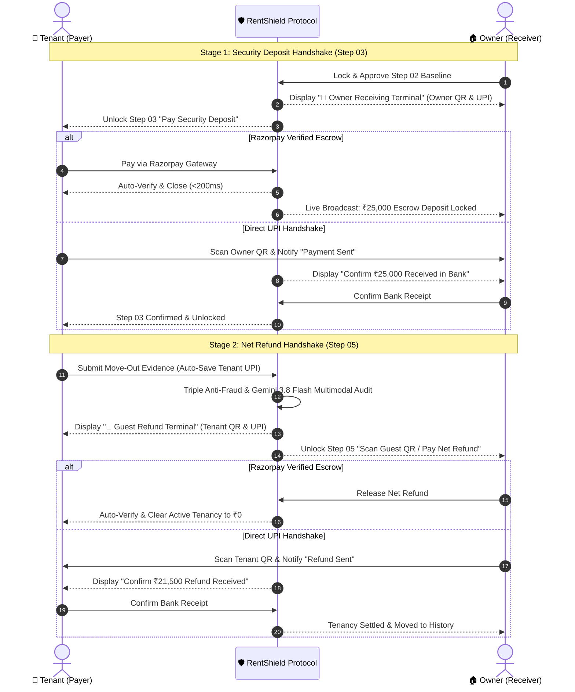
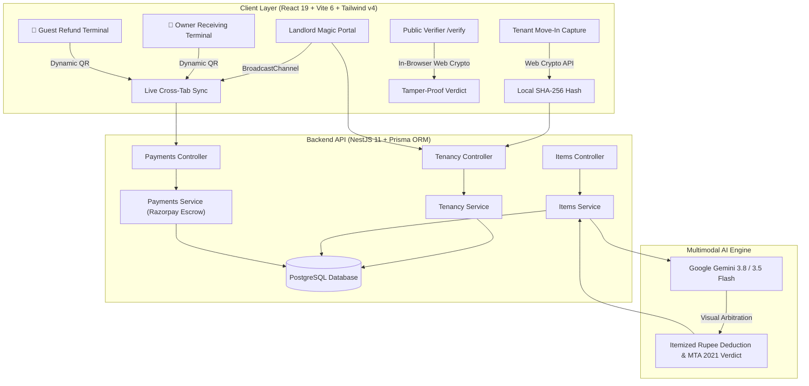

# RentShield 🛡️

[](https://devfolio.co)
[](https://github.com/priyam242/CODEFESTTHON-2026)
[](https://github.com/priyam242/CODEFESTTHON-2026)

> **Built during CODEFESTTHON 2026 (Hosted on Devfolio)**  
> *A Zero-Tamper Rental Inventory & Multimodal AI Security Deposit Arbitration Protocol.*

---

## ⚡ The Problem & The Solution

In urban rental markets across India, over **₹1.2 Lakh Crore ($15B+)** in tenant security deposits is held by property owners. At move-out, tenants routinely lose **20% to 50%** of their deposits due to arbitrary, unsubstantiated deductions ("wall scuffs", "worn fixtures", "old appliances") with zero verifiable baseline of move-in condition.

**RentShield eliminates deposit disputes through cryptographic verification and objective AI arbitration:**
1. **Cryptographic Move-In Seal:** Tenants photograph fixtures during move-in. The browser's native **Web Crypto API** immediately computes local **SHA-256 byte fingerprints**, sealing the condition into an aggregate cryptographic fingerprint before landlord review.
2. **Landlord Magic Link Lock:** The property owner reviews and locks the baseline condition via a one-time token link. Once approved, the move-in inventory is cryptographically immutable.
3. **Gemini 2.5 Flash Damage Arbitration:** At move-out, tenants log exit photos. Google’s **Gemini 2.5 Flash** multimodal model objectively evaluates before/after condition, distinguishing **normal wear-and-tear** (₹0 cut) from **genuine negligence**, generating itemized rupee repair recommendations.
4. **Client-Side Zero-Knowledge Verifier (`/verify`):** Anyone (judges, landlords, legal arbitrators) can drop an inventory certificate PDF or photo into the browser. The file is hashed in memory and verified against the sealed fingerprint—**the file is never uploaded to any server during verification**.
5. **Multi-Tab Real-Time Sync:** Built using HTML5 `BroadcastChannel` (`rentshield_live_sync`) allowing simultaneous dual-actor evaluation (Tenant in Tab 1, Landlord in Tab 2) with instant zero-refresh emerald status badges.

---

## 🏛️ System & Two-Party Escrow Architecture





---

## 🏆 Judge Quick-Test Guide (Dual-Screen Evaluation in 60s)

To evaluate the complete real-world two-party handshake:
1. **Open Two Browser Windows Side-by-Side:**
   - **Left Window:** Open `https://rentshield-web.onrender.com/login` and click **"1-Click Demo Login as Tenant"** (`priyam@gmail.com` / `priyam1200`).
   - **Right Window:** Open `https://rentshield-web.onrender.com/login` and click **"1-Click Demo Login as Landlord"** (`rajesh@gmail.com` / `rajesh6005`).
2. **Create & Live Sync Tenancy:**
   - In Left Tab, click `+ New Tenancy`, enter ₹25,000 deposit, and submit.
   - Watch the Right Tab update **instantly with 0 page refreshes** via HTML5 BroadcastChannel!
3. **Inspect & Approve Baseline:**
   - Left Tab: Upload a living room photo under Step 01.
   - Right Tab: Open Landlord Verify portal, review photo, check the confirmation box, and click **"Lock & Approve Baseline"**.
4. **Experience Stage 1 Deposit Handshake:**
   - Right Tab immediately renders the **"🏦 Owner Receiving Terminal"** displaying the Owner's live QR Code and UPI ID.
   - Left Tab: Click **"Pay Security Deposit"** and choose Razorpay Escrow or Direct UPI. In test mode, it verifies in <200ms!
5. **Trigger Triple Anti-Fraud & Gemini Multimodal Audit:**
   - Left Tab: In Step 04 Move-Out, try uploading a duplicate photo (detected!), or a selfie portrait (scene mismatch blocked!), then upload the authentic damaged sofa.
   - Click **"Run AI Damage Audit"**: Google Gemini arbitrates fair wear-and-tear vs negligence under MTA 2021.
6. **Experience Stage 2 Net Refund Handshake:**
   - Left Tab immediately displays the **"💸 Guest Refund Receiving Terminal"** with Tenant's live QR Code.
   - Right Tab: Click **"Scan Guest QR / Pay Net Refund"** and release payout.
   - Both screens auto-clear to ₹0 active deposit and transfer the contract into Settled History!
7. **Download Official Documents:**
   - Tenant accesses **"Society Gate Pass & NOC"**; Owner downloads/prints **"Official Escrow Settlement Receipt"**.

---

## 🚀 1-Click Judge Credentials & Quickstart

For evaluating judges, RentShield includes pre-configured demo credentials and automated database seeding:

### 1-Click Quick Login (On `/login`)
- **Tenant Persona:**  
  `tenant.demo@rentshield.com` | `password123`  
  *(Aarav Sharma — Active 2BHK Tenancy in Indiranagar, Bangalore with pre-hashed fixtures)*
- **Landlord Persona:**  
  `landlord.demo@rentshield.com` | `password123`  
  *(Ramesh Malik — Property Owner review & approval portal)*

### Local Setup in 2 Commands
```bash
# 1. Install all monorepo dependencies
pnpm install

# 2. Run both NestJS API (port 4000) and React client (port 5173) concurrently
pnpm dev
```
Open **[http://localhost:5173](http://localhost:5173)** in your browser.  
*(Note: Visiting `http://localhost:4000` automatically redirects to `http://localhost:5173`).*

---

## 🛡️ Mandatory Devfolio Code of Conduct & Third-Party Disclosures

Per Devfolio's Hackathon Code of Conduct, we explicitly disclose all third-party libraries, boilerplates, and tools utilized:

| Category | Technology / Package | Disclosure & Scope |
| :--- | :--- | :--- |
| **Framework Boilerplates** | NestJS CLI & Vite React TS Starter | Used solely for baseline directory scaffolding. |
| **Multimodal AI** | `@google/genai` (Gemini 2.5 Flash) | AI arbitration prompt engineering and structured schema parsing built during the hackathon. |
| **Cryptography** | W3C Web Crypto API (`window.crypto.subtle`) | Standard native browser API used for zero-server in-browser SHA-256 byte hashing. |
| **UI & Styling** | Tailwind CSS v4, Lucide Icons | Component styling and icon design. |
| **Export Engine** | `jspdf` | Client-side cryptographic condition report PDF generation. |
| **Database & ORM** | Prisma ORM 6 & PostgreSQL | Data modeling with custom resilient in-memory fallback for offline continuity. |

**Declaration:** 100% of the domain business logic, the dual-tab `BroadcastChannel` synchronization engine, the cryptographic hash aggregation pipeline, the public verifier page, and the rental deposit arbitration system were conceived and developed exclusively during **CODEFESTTHON 2026**.

---

## 📂 Repository Structure

```
├── client/                     # React 19 + TypeScript + Vite 6 Frontend
│   ├── src/
│   │   ├── components/         # Navbar, Status Badges
│   │   ├── pages/
│   │   │   ├── Dashboard.tsx   # Tenancy overview & live sync status
│   │   │   ├── TenancyDetail.tsx # 4-step progressive inspection sidebar
│   │   │   ├── LandlordVerify.tsx # Landlord magic link approval portal
│   │   │   ├── PublicVerifier.tsx # Zero-upload drag-and-drop SHA-256 verifier
│   │   │   └── Login.tsx       # 1-Click Judge quick logins
│   │   ├── realtimeSync.ts     # HTML5 BroadcastChannel cross-tab engine
│   │   └── api.ts              # Axios client with multi-tab session isolation
├── server/                     # NestJS 11 Backend API
│   ├── src/
│   │   ├── ai-audit/           # Gemini 2.5 Flash multimodal arbitration service
│   │   ├── auth/               # Passport JWT authentication & role management
│   │   ├── items/              # Room fixtures, photo upload & hashing
│   │   ├── tenancy/            # Tenancy lifecycle, magic tokens & certificates
│   │   └── prisma/             # Prisma client with resilient in-memory fallback
├── prisma/
│   └── schema.prisma           # Tenancy, Item, and User models
└── output.txt                  # (Ignored from git) Local execution log
```

---

## ⚖️ License
Licensed under the [MIT License](LICENSE). Built with pride for **CODEFESTTHON 2026**.
