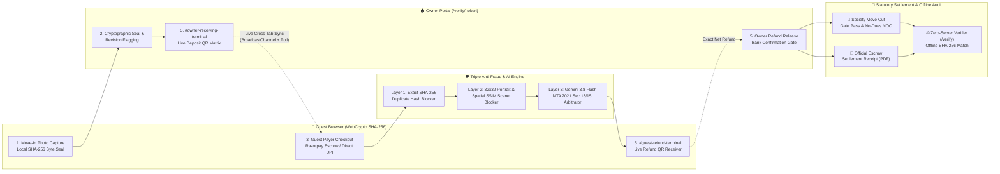

<div align="center">

# 🛡️ RentShield
### Autonomous Cryptographic & AI Rental Security Deposit Cyber-Escrow

[](https://rentshield-web.onrender.com)
[](https://github.com/priyam242/CODEFESTTHON-2026)
[](https://rentshield-api.onrender.com/api/tenancy/ai-health)
[](https://rentshield-web.onrender.com/verify)
[](https://rentshield-web.onrender.com/verify)

**Eliminating unfair security deposit deductions across India's ₹40,000+ Crore urban rental market using zero-tamper in-browser SHA-256 seals, real-world Two-Party QR Escrow Terminals, a Triple Anti-Fraud Engine, and Google Gemini 3.8 Flash Multimodal Arbitration.**

[🚀 Launch Live App](https://rentshield-web.onrender.com) • [⚖️ Courtroom Verifier (`/verify`)](https://rentshield-web.onrender.com/verify) • [🩺 Live AI Health](https://rentshield-api.onrender.com/api/tenancy/ai-health)

</div>

---

## 🌐 Live Deployment & 1-Click Judge Credentials

Judges can test the entire **Dual-Tab Real-Time Split-Screen Handshake** (Guest in Window 1 + Property Owner in Window 2) directly on production with zero setup:

| Surface / Account | Live Endpoint / Credentials | Notes |
| :--- | :--- | :--- |
| **Live Web App (PWA)** | **[https://rentshield-web.onrender.com](https://rentshield-web.onrender.com)** | Installable Progressive Web App with animated Cyber-Shield splash |
| **Live API Health** | **[https://rentshield-api.onrender.com/api/tenancy/ai-health](https://rentshield-api.onrender.com/api/tenancy/ai-health)** | Auto-discovers active multimodal Gemini models (`3.8-flash` / `3.5-flash-lite` / `4-hydrogen`) |
| **Courtroom Verifier** | **[https://rentshield-web.onrender.com/verify](https://rentshield-web.onrender.com/verify)** | Zero-server, offline WebCrypto SHA-256 evidence byte matcher |
| **1-Click Judge Demo** | Click **"Demo as Tenant"** or **"Demo as Owner"** on `/login` | Self-healing seeded PostgreSQL state for instant evaluation |
| **Guest / Tenant Login** | `priyam@gmail.com` / `priyam1200` | Priyam Prajapati (`TENANT` — Step 01, 03, 04, 05 Terminal, NOC) |
| **Owner / Landlord Login** | `rajesh@gmail.com` / `rajesh6005` | Rajesh Prajapati (`LANDLORD` — Step 02 Lock, Step 03 Terminal, Step 05 Payout, Tax Receipt) |

---

## ⚡ Why RentShield?

Every year in India, **₹40,000+ Crore** in rental security deposits is trapped in unilateral disputes where tenants lose 20–50% of their money to vague claims (*"wall scuffs"*, *"old sofa wear"*) without immutable baseline proof or neutral arbitration.

RentShield replaces verbal trust with a **6-Step Cryptographic Cyber-Escrow Protocol**:
1. **Step 01 — In-Browser SHA-256 Baseline:** Guest uploads move-in photos; `window.crypto.subtle` seals raw byte hashes locally before storage.
2. **Step 02 — Landlord Magic-Link Seal:** Owner inspects hashes via `/verify/:token`, flags revisions if needed, confirms UPI VPA, and cryptographically locks the contract.
3. **Step 03 — Real-World Two-Party Deposit Terminal:** Owner's screen displays `#owner-receiving-terminal` with a live NPCI QR matrix; Guest's checkout modal (zero duplicate QR) offers Razorpay Verified Escrow or Direct UPI with a **zero self-approval anti-bypass gate**.
4. **Step 04 — Triple Anti-Fraud + Gemini 3.8 Flash Arbitration:**
   - **Gate 1:** Client + Server SHA-256 duplicate-photo detector blocks re-uploaded move-in photos.
   - **Gate 2:** `32x32` spatial chrominance/skin-cluster & SSIM detector blocks selfies, blank screens, and off-room UI screenshots.
   - **Gate 3:** Google Gemini 3.8 Flash compares baseline vs. exit photos under **Indian Model Tenancy Act (MTA) 2021 Sec 13 & 15**, separating normal wear-and-tear (`₹0`) from genuine negligence.
5. **Step 05 — Guest Refund Receiving Terminal:** Guest's screen mounts `#guest-refund-terminal` with their auto-saved UPI QR for the exact post-audit net refund; settlement clears **both** dashboards to `₹0` Active Deposit cleanly.
6. **Step 06 — Statutory Documents & Offline Courtroom (`/verify`):** Generates a scannable **Society Move-Out Gate Pass & NOC**, a tax-ready **Official Escrow Settlement Receipt**, and lets anyone verify photo integrity offline in-browser.

---

## 🏛️ System Architecture



---

## 🛠️ Tech Stack

| Layer | Technologies |
| :--- | :--- |
| **Frontend** | React 19, TypeScript, Vite 6, Tailwind CSS v4, Lucide Icons, `qrcode`, `jspdf`, W3C Web Crypto API (`crypto.subtle`) |
| **Backend** | NestJS 11, TypeScript, Prisma ORM 6, Passport JWT, Multer |
| **Database** | Neon Serverless PostgreSQL |
| **AI & Vision** | Google Gemini 3.8 Flash / 3.5 Flash Lite / 4 Hydrogen (Multimodal Vision + Native TTS `Puck`) |
| **Payments** | Two-Party Direct NPCI UPI Terminals + Razorpay Verified Escrow Gateway |
| **Testing & QA** | Playwright E2E Suite (`12/12` scenarios passing), FFmpeg 60fps automated verification |

---

## 💻 Local Monorepo Quickstart

### Prerequisites
- Node.js `>= 20` & `pnpm` (`>= 9`)
- PostgreSQL database URL (`DATABASE_URL`) & `GEMINI_API_KEY` in `server/.env`

### Setup & Run
```bash
# 1. Install dependencies across client & server workspaces
pnpm install

# 2. Push Prisma schema to PostgreSQL
pnpm --filter rentshield-server exec prisma db push

# 3. Start both NestJS API (:4000) and React Vite client (:5173)
pnpm dev
```

### Verification Commands
```bash
# Typecheck & production builds
pnpm --filter rentshield-server build
pnpm --filter rentshield-client build

# Run full Playwright E2E test suite (12 scenarios)
pnpm --filter rentshield-client test:e2e
```

---

## 📂 Monorepo Structure

```text
├── client/                     # React 19 + Vite 6 + Tailwind v4 Frontend
│   ├── e2e/                    # 12-scenario Playwright end-to-end suite
│   └── src/
│       ├── components/         # PaymentModal, SocietyGatePassModal, EscrowReceiptModal, IntroSplash
│       ├── pages/              # Dashboard, TenancyDetail, LandlordVerify, PublicVerifier (/verify)
│       ├── utils/              # escrowSequence.ts shared 6-step state machine
│       └── realtimeSync.ts     # BroadcastChannel + silent background sync hook
├── server/                     # NestJS 11 Backend API
│   ├── prisma/                 # Prisma schema (User, Tenancy, Item)
│   └── src/
│       ├── ai-audit/           # Gemini 3.8 Flash multimodal arbitration & native TTS engine
│       ├── items/              # Evidence ingestion, SHA-256 verification, move-out audit
│       ├── payments/           # Two-party Payer/Receiver escrow & Razorpay order verification
│       └── tenancy/            # Lifecycle, landlord magic tokens, public certificates
└── scripts/                    # Automated Playwright + Gemini TTS demo & proof pack pipelines
```

---

<div align="center">
Built with cryptographic rigor during <strong>CODEFESTTHON 2026</strong> • Licensed under MIT
</div>
